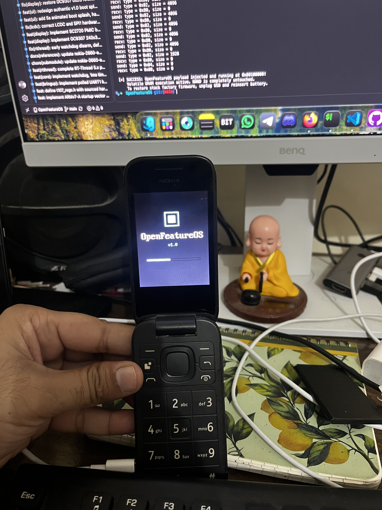

# OpenFeatureOS

[](LICENSE)
[](#target-hardware-specifications)
[-red.svg)](#target-hardware-specifications)
[-brightgreen.svg)](https://github.com/RT-Thread/rt-thread)
[-9cf.svg)](https://github.com/lovelytingy/Nokia-2660-Emulator)
[-success.svg)](#execution-model--safety-guarantee)
[](#development-roadmap)

<a href="https://buymeacoffee.com/lovelytingy"></a>

> [!WARNING]
> **Active Development Notice**: OpenFeatureOS is currently in active development. Features, hardware drivers, and user interface workflows are undergoing rapid changes. Some features might not work as intended or may be incomplete on certain hardware revisions. Testing feedback, logs, and pull requests are warmly welcomed!

**OpenFeatureOS** is an open-source, lightweight operating system purpose-built for 4G feature phones. It is based on **RT-Thread**, implemented strictly in **C and ARM assembly**, and targets the **Unisoc T107 (UMS9117)** SoC on the **Nokia 2660 Flip (Model TA-1480)**.

<div align="center">
  <br>
  
  <p><em>Physical hardware verification: OpenFeatureOS v1.0 executing live in volatile DRAM on the Nokia 2660 Flip (TA-1480 / Unisoc T107) 2.8" QVGA display.</em></p>
  <br>
</div>

> [!IMPORTANT]
> **Legal Notice & Non-Affiliation**: This project is an independent open-source research effort and is **not affiliated with, sponsored by, or endorsed by Nokia Corporation, HMD Global Oy, or Unisoc Technologies Co., Ltd.** All trademarks belong to their respective owners. **No proprietary firmware binaries are distributed in this repository.** See [DISCLAIMER.md](DISCLAIMER.md) for full legal terms.

---

## Target Hardware Specifications

| Component | Specification | Verification Source |
| :--- | :--- | :--- |
| **Target Device** | Nokia 2660 Flip (Model TA-1480, HW3.0, India Variant) | Product label & PAC manifest |
| **SoC / Platform** | Unisoc T107 / UMS9117 (Single-core ARM Cortex-A7 @ up to 1.0 GHz) | Chip ID `0x98180001` |
| **Volatile RAM** | 48 MB SIP LPDDR2 DRAM (base address `0x80000000`) | DMC memory controller |
| **Internal Flash** | 128 MB SPI NAND Flash (Winbond W25N01GV) | Partition map & NAND driver |
| **Primary Display** | 2.8" QVGA 240×320 TFT LCD (GalaxyCore GC9307 via SPI1) | SPI1 ReadID `0x009307` |
| **Sub Display** | 1.77" QQVGA 128×160 TFT LCD (Sitronix ST7735 via SPI) | Kernel driver symbols |
| **Keypad** | APB 5×5 Matrix Scanner (`0x40250000`) | Hardware register map |
| **Power Button** | Dedicated PMIC EIC Line Pin 1 (`0x40608280` bit 1) | SC2720 PMIC EIC |
| **PMIC Companion**| Unisoc SC2720 (Torch `0x40608df4`, Vibrator LDO `0x40608e00`) | ADI serial bus |
| **Debug Serial** | UART1 at `0x70100000` (1.8V TTL, 115,200 baud 8N1) | BootROM / boot0 / kernel console |
| **Power MCU** | Auxiliary ARM Cortex-M4 (`pm_cm4.bin` / LPDDR self-refresh) | Power management subsystem |
| **Modem / DSP** | Dual CEVA baseband DSPs (closed firmware; out of scope) | Modem subsystem |

---

## Execution Model & Safety Guarantee

> [!TIP]
> **Zero Risk of Bricking**: In this development phase, OpenFeatureOS runs **strictly in volatile DRAM**.
> - Loaded via USB download mode (BSL/FDL1) with `spd_dump` to address **`0x80100000`** (entry point **`0x80100200`**).
> - On-board SPI NAND flash, boot partitions, NVRAM items, and eFuses are **never modified or written to**.
> - Disconnecting USB and reseating the battery immediately restores the phone to factory condition.
> - Secure boot bypasses and flash flashing are deliberately out of scope for this phase.

---

## Host Operating System Requirements

### Supported Platforms
* **Linux**: Fully supported (Ubuntu, Debian, Fedora, Arch Linux, and derivative distributions).
* **macOS**: Fully supported (Apple Silicon M1/M2/M3/M4 & Intel x86_64).

> [!WARNING]
> **Windows Compatibility Notice**:
> OpenFeatureOS development and toolchains are designed and maintained exclusively for **Linux** and **macOS**. We do **not** provide any support, bug fixes, or compatibility promises for native Windows environments. Issues or pull requests regarding native Windows compilation will be **respectfully declined and closed**.
> 
> Windows users are encouraged to use **WSL2 (Windows Subsystem for Linux)** with an Ubuntu environment.

---

## Toolchain & Host Setup

### Language & Compiler Policy
- **C and ARM assembly only**. No C++, no Rust.
- Assembly (`.S`, GNU as syntax) is restricted to startup, exception vectors, context switching, and cache/MMU primitives.
- All driver logic and OS components are written in C (C99 / GNU99).
- Cross-compiler: `arm-none-eabi-gcc` targeting Cortex-A7 (`-mcpu=cortex-a7 -marm`).

### Installation

#### macOS (Homebrew)
```bash
brew install --cask gcc-arm-embedded
brew install make python3
```

#### Ubuntu / Debian / Linux Mint
```bash
sudo apt update && sudo apt install -y \
    gcc-arm-none-eabi \
    binutils-arm-none-eabi \
    libnewlib-arm-none-eabi \
    make \
    python3
```

#### Arch Linux
```bash
sudo pacman -S arm-none-eabi-gcc arm-none-eabi-binutils arm-none-eabi-newlib make python
```

#### Fedora
```bash
sudo dnf install arm-none-eabi-gcc-cs arm-none-eabi-newlib make python3
```

---

## Quick Start

### 1. Build the OS Payload
```bash
make
```

Build outputs in `build/`:
- `openfeatureos.elf`: Unstripped ELF with debug symbols.
- `openfeatureos.raw`: Flat binary payload.
- `openfeatureos.bin`: DHTB-encapsulated binary ready for DRAM loading at `0x80100000`.

### 2. Run in the Hardware Emulator
OpenFeatureOS includes the [Nokia-2660-Emulator](https://github.com/lovelytingy/Nokia-2660-Emulator) as a pinned submodule for instant smoke testing:

```bash
make emu
```

### 3. Generate Disassembly
```bash
make disasm
```

---

## Repository Structure

```
OpenFeatureOS/
├── board/                           # Board support package (linker script, startup.S, t107_regs.h)
├── docs/                            # Deep-dive architecture and toolchain documentation
│   ├── images/                      # Hardware photography & screenshots
│   ├── REFERENCES.md                # Submodule SHAs, emulator report, citation rules
│   └── TOOLCHAIN.md                 # Compiler flags, ABI, and toolchain guide
├── include/                         # OS headers and API declarations
├── scripts/
│   └── mkdhtb.py                    # 512-byte DHTB header generator for FDL1 BSL
├── src/                             # Core C operating system & driver implementations
├── third_party/                     # Pinned reference submodules
│   ├── nokia-2660-re                # RE documentation & working payloads (GPL-3.0)
│   ├── nokia-2660-emulator          # Unisoc T107 hardware emulator (MIT)
│   └── rt-thread                    # Upstream RT-Thread RTOS (Apache-2.0)
├── DISCLAIMER.md                    # Legal disclaimer, fair use, & IP notice
├── Makefile                         # Unified GNU Makefile
├── README.md                        # Project overview
└── LICENSE                          # GNU General Public License v3.0
```

---

## Development Roadmap

- [x] **Phase 1: Project Foundation & Environment**
  - Repository structure, unified Makefile, and toolchain setup.
  - Pinned submodules (`Nokia-2660-RE`, `Nokia-2660-Emulator`, `rt-thread`).
  - Legal disclaimer, licensing guidelines, and reference inventory (`docs/REFERENCES.md`).
- [x] **Phase 2: Linker Script & Startup Vector Bootstrap**
  - Linker script for DRAM `0x80100000` with 512-byte DHTB offset.
  - ARM startup code (`startup.S`): exception vectors, stack bank setup, BSS clear, CPU mode handling.
- [x] **Phase 3: Hardware Register Header (`board/t107_regs.h`)**
  - Fully sourced hardware constants and peripheral base registers tagged with hardware references.
- [x] **Phase 4: Early Bringup & Signs of Life**
  - Polled UART1 debug serial driver (`0x70100000`) and early `kprintf`.
  - SC2720 PMIC ADI bus, flashlight LED driver, and GPIO control.
- [x] **Phase 5: Core Hardware Timers, INTC, & MMU**
  - Hardware timer tick, SPRD 32-line interrupt controller, and CP15 MMU/cache configuration.
- [x] **Phase 6: RT-Thread Kernel Port**
  - Cortex-A7 `libcpu` architecture port, cooperative scheduling, thread management, and idle tick.
- [ ] **Phase 7: Emulator & QEMU Smoke Tests**
  - Automated CI verification with `Nokia-2660-Emulator` (both headless and native desktop GUI).
- [x] **Phase 8: Peripheral Drivers & UI**
  - APB keypad matrix scanner driver and SC2720 PMIC EIC Power button (tested on physical hardware).
  - GalaxyCore GC9307 SPI1 LCD driver (240×320 QVGA) with LCDC DMA and PWM backlight control.
  - LVGL GUI framework with animated boot splash, modern Home UI, Phone Dialer, Flashlight Tool, and System Debug Telemetry.

---

## Ecosystem & Companion Projects

* 🔬 [**Nokia-2660-RE**](https://github.com/lovelytingy/Nokia-2660-RE): Research, partition dumps, memory maps, and bare-metal DRAM payloads for the Nokia 2660 Flip.
* 🕹️ [**Nokia-2660-Emulator**](https://github.com/lovelytingy/Nokia-2660-Emulator): High-performance pure-Rust hardware emulator for the Unisoc T107 platform, providing the official virtualized dev deck for OpenFeatureOS.

---

## ❤️ Support My Work

OpenFeatureOS is an independent open-source project. If you find this project exciting and want to support hardware research, feature phone bringup, and ongoing development:

<a href="https://buymeacoffee.com/lovelytingy"></a>

---

## License

OpenFeatureOS is licensed under the [GNU General Public License v3.0 (GPL-3.0)](LICENSE).
Third-party reference projects maintain their respective upstream licenses:
- `third_party/nokia-2660-re`: GNU GPL v3.0
- `third_party/nokia-2660-emulator`: MIT License
- `third_party/rt-thread`: Apache License 2.0
